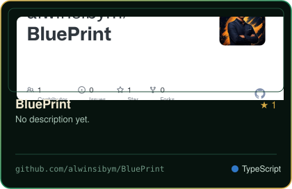
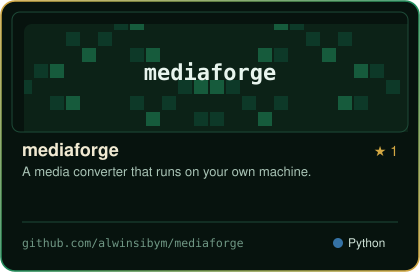
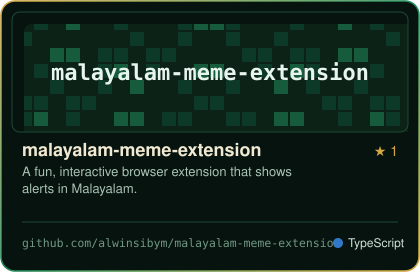
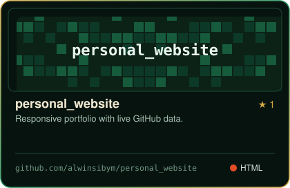

The window shows the weather in Kottayam, the clock shows local time, the monitor scrolls my latest commits and each book on the shelf is a language I write. The lamp comes on from dusk until dawn. Refreshed every 15 minutes.

  

---

## About

MCA student (2025–2027) at SJCET, Palai, based in Kottayam, Kerala. I build full-stack web applications and AI-assisted tools, and I'm aiming for an entry-level software developer role in full-stack or AI engineering.

- Working on **BluePrint**, a planning platform that uses local multi-agent LLMs to turn a software idea into requirements, architecture and a project scaffold.
- Shipped **MediaForge**, a self-hosted media converter built with FastAPI, yt-dlp and FFmpeg, with tests, CI and Docker.
- Improving data structures and algorithms alongside backend development.

---

## Projects

<!--CARDS:START-->

<table><tr><td></td><td></td></tr><tr><td></td><td></td></tr></table>

<!--CARDS:END-->

---

## Activity

<!--LATEST:START-->

Latest push: <a href="https://github.com/alwinsibym/alwinsibym"><b>alwinsibym</b></a> ·  · 2d ago

<!--LATEST:END-->

---

## Stack

---

<i>“I focus on building systems, not just completing tutorials.”</i>

